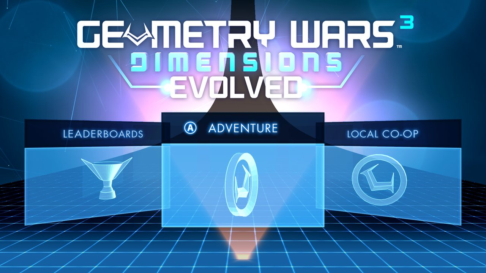
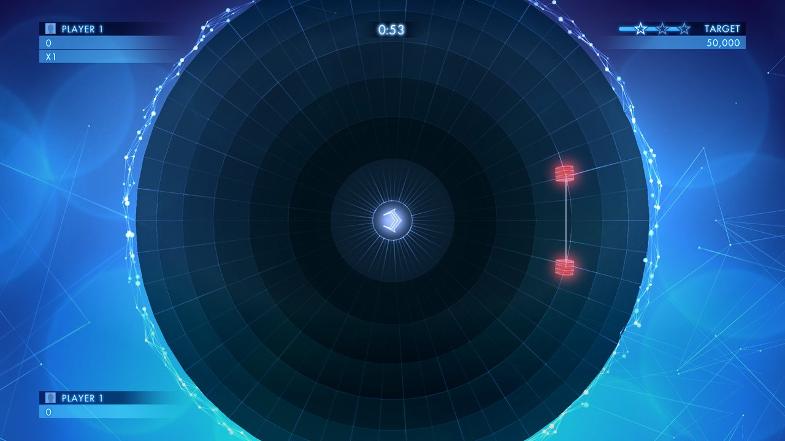
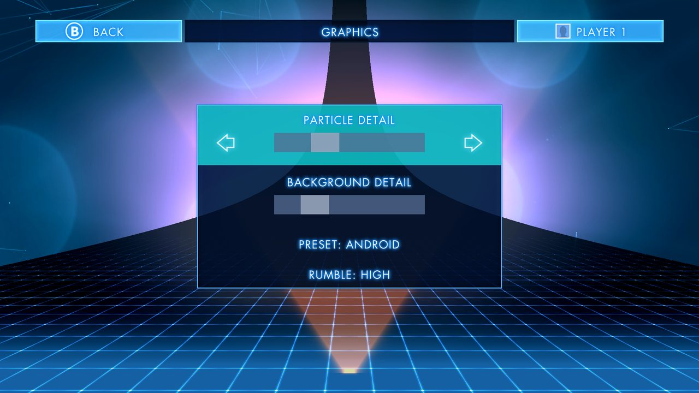
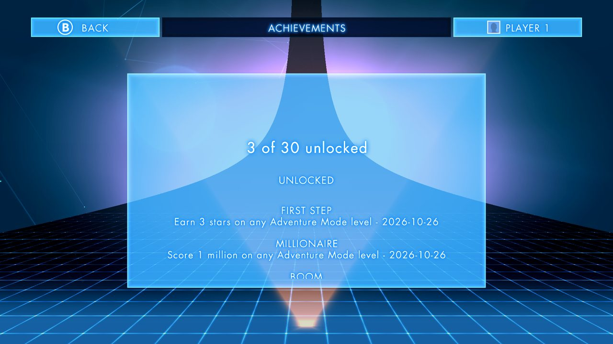
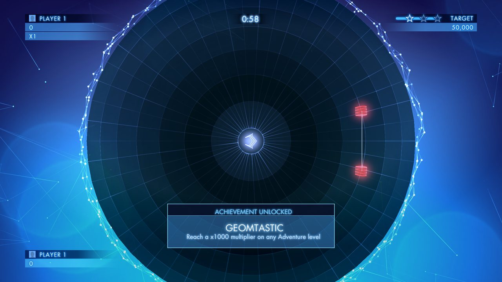

# gw3nx

**Geometry Wars 3: Dimensions Evolved on the Nintendo Switch.** A native homebrew port of the Android
version: the game's original ARM code runs unmodified through a JIT, with the Android pieces it expects
rebuilt for the Switch.

> **Bring your own game.** This repository contains no game code or assets. You need your own copy of the
> Android version of Geometry Wars 3: Dimensions (the APK and its OBB data file).



<table>
  <tr>
    <td></td>
    <td> Graphics"></td>
  </tr>
  <tr>
    <td></td>
    <td></td>
  </tr>
</table>

<sub>Screenshots are from the PC build of the same code at 1920×1080.</sub>

## Features

- **The full 1.3.0 "Evolved" game** with its console interface: Adventure, Local Co-op, Hardcore, Classic,
  Ultimate, Options and Achievements, all driven by controller.
- **60 fps**, **1080p docked** and **720p handheld**.
- **Local co-op for up to 4 players** with Joy-Con, Pro Controller or handheld mode.
- **Switch controls**: A confirms and B goes back, the d-pad works in every menu, and the on-screen prompts
  show L / R / ZL / ZR instead of Xbox buttons.
- **Options > Graphics**, a new page inside the game's own Options screen:
  - **Preset**: Android, Console (the PS4 / Xbox One values, closest to PC) or Max.
  - **Particle detail** and **Background detail** sliders. The Android release ran at about 40% of the
    console effects; you can go up to 150%.
  - **Rumble**: Off, Low, Medium or High.
- **HD Rumble** on smart bombs, deaths, boss hits and boss kills. The Android version had none.
- **Offline achievements**: all 30 are tracked on the SD card, shown on the game's own Achievements screen,
  with an unlock pop-up in the game's style. No Google Play needed.
- **Auto-pause** when you press HOME or put the console to sleep mid-level.
- **Fast loading**: the game data is read into memory once at startup.
- **Saves** go to the SD card.

## Requirements

- A Nintendo Switch running [Atmosphère](https://github.com/Atmosphere-NX/Atmosphere).
- **Title takeover**, not applet mode: the game needs about 3 GB of memory. Launch the homebrew menu by
  holding **R** while starting any installed game, not from the Album.
- Your own copy of the Android game. Version **1.3.0 (build 101)** is recommended; 1.0.0 also runs but has
  the phone interface.

## Installation

1. Download `gw3nx.nro` from the [Releases](../../releases) page.
2. From your copy of the game, collect these four files:
   - `libgwnext.so`, `libfmodex.so` and `libfmodevent.so`, from the APK's `lib/armeabi-v7a/` folder (an APK
     is a zip file; rename it to `.zip` to open it).
   - `main.101.com.activision.gw3.dimensions.obb`, the data file. On a phone it lives in
     `Android/obb/com.activision.gw3.dimensions/`.
3. Copy all five files to **`sdmc:/switch/gw3/`** on the SD card.
4. Hold **R** while launching any game to open the homebrew menu, then start **Geometry Wars 3: Dimensions**.

The first launch takes a little while: the JIT is translating the game's code. The game is fully playable
once the menu appears.

## Controls

| Button | Menus | In a level |
|---|---|---|
| Left stick / d-pad | Move the selection | Move |
| Right stick | | Shoot |
| A | Confirm | |
| B | Back | |
| ZL | | Super |
| ZR | | Smart bomb |
| + | | Pause |
| − (hold 1 s) | gw3nx menu | gw3nx menu |

The **gw3nx menu** has quick effect presets, an FPS counter and a compact achievements list.

## Files on the SD card

Everything lives in `sdmc:/switch/gw3/`:

| File | What it is |
|---|---|
| `savegame.dat`, `cloudsave.bin` | Your save (written by the game) |
| `gw3nx.ini` | Port settings: effect detail, rumble, FPS counter |
| `achievements.txt` | Unlocked achievements and their dates |
| `gw3.log`, `watchdog.log` | Logs from the last run; attach them to bug reports |

## Versions of the game

| | 1.0.0 (builds 35 / 41) | 1.3.0 "Evolved" (build 101) |
|---|---|---|
| Interface | Phone UI, touch-first | TV / console UI, controller-first |
| Evolved level pack | Not included | 41 extra levels |
| Main menu | Phone menus | Ring with Adventure, Local Co-op, Hardcore, Classic, Ultimate, Leaderboards, Options, Achievements |
| Data file | `main.35…obb` | `main.101…obb` |

## Known limitations

- **Online features** (online leaderboards, friends' scores, Facebook, cloud sync) need servers that no
  longer exist, so they are off.
- **Docking or undocking mid-session** scales the picture until the next launch; the game picks its
  resolution at startup.
- **In co-op every controller rumbles**, not only the one belonging to the player.
- **Achievement names** follow the game's internal order matched to the public achievement list; if an
  unlock shows the wrong name, please open an issue.

## Troubleshooting

- **The game closes or freezes**: open an issue and attach `gw3.log` and `watchdog.log` from
  `sdmc:/switch/gw3/`. If Atmosphère showed an error screen, also attach the newest file from
  `sdmc:/atmosphere/crash_reports/`.
- **"Not enough memory" or an immediate crash**: make sure you launched through title takeover (hold R on a
  game), not from the Album.
- **A black screen on first launch** is normal for a while.

## Building

### Get the source and dependencies
```sh
git clone https://github.com/<you>/gw3nx && cd gw3nx
tools/fetch_deps.sh   # dynarmic at the pinned commit, with patches/dynarmic-switch.patch applied
```

### PC (Linux, x86-64): the development loop
```sh
sudo apt install cmake g++ libsdl2-dev libgles-dev libboost-dev
cmake -S . -B build && cmake --build build -j
./build/gw3nx <folder with the game files> [frames] [screenshot.ppm]
```
Debug options (environment variables): `GW3_TRACE=<lib>` logs every call made from that library,
`GW3_SCRIPT="300:0,420:0"` presses button bit N on those frames, `GW3_SHOTS="600,900"` saves screenshots,
`GW3_RES=1920x1080` sets the window size, `GW3_STOCK=1` shows the menus as the Android release had them.

### Nintendo Switch
Needs devkitPro (devkitA64, libnx, switch-tools), the portlibs `switch-sdl2`, `switch-mesa` and
`switch-libdrm_nouveau`, and Boost headers (header-only) in the include path:
```sh
dkp-pacman -S switch-dev switch-sdl2 switch-mesa
# copy the Boost headers into $DEVKITPRO/portlibs/switch/include
tools/make_icon.sh path/to/your.apk   # optional: HOME menu icon from your APK (icon.jpg, gitignored)
cmake -S . -B build-nx -DCMAKE_TOOLCHAIN_FILE=cmake/switch.cmake && cmake --build build-nx -j
# -> build-nx/gw3nx.nro
```
If the devkitPro package servers aren't reachable, `tools/build_dka64.sh` and `tools/build_portlibs.sh`
build the whole stack from source (GCC 16.1 with devkitPro's newlib, libnx, switch-tools, Mesa 20.1,
SDL 2.28). The released `.nro` was built that way. They clone into `$TC` (default `~/gw3nx-toolchain`) and
install to `/opt/devkitpro`.

## How it works

The Android game is a 32-bit ARM library (`libgwnext.so`) plus FMOD. gw3nx loads those ELF files into a
32-bit guest address space and runs them with the [dynarmic](https://github.com/azahar-emu/dynarmic) JIT
(ARMv7 → AArch64 on Switch, ARMv7 → x86-64 on PC). Every function the game imports from Android is
answered by a small host runtime:

| Piece | File |
|---|---|
| Guest memory, one JIT per thread, host ↔ guest calls, hooks | `src/core.cpp` |
| ELF loader, relocations, symbols, crash symbolication | `src/loader.cpp` |
| bionic libc / libm / pthreads / stdio / setjmp / futex | `src/hle_libc.cpp` |
| OpenGL ES 2 bridge | `src/hle_gl.cpp`, `src/gl_table.inc` |
| Fake Java VM and JNIEnv (the Java side of the Android app) | `src/jni.cpp` |
| AAssetManager over the OBB archive, ARM EABI helpers | `src/hle_android.cpp` |
| OpenSL ES → SDL2 audio for FMOD | `src/hle_opensl.cpp` |
| Boot sequence, input, rumble, game fixes | `src/main.cpp` |
| Options > Graphics, achievements screen (built from the game's own UI) | `src/options.cpp` |
| gw3nx menu, achievements, pop-up in the game's font | `src/overlay.cpp` |

Switch specifics: dynarmic is patched for libnx's CodeMemory JIT (separate writable and executable views)
and for Horizon's scheduler, which never preempts threads of equal priority (`patches/dynarmic-switch.patch`).

## Credits

- [dynarmic](https://github.com/azahar-emu/dynarmic), [libnx](https://github.com/switchbrew/libnx),
  [devkitPro](https://devkitpro.org), Mesa and SDL2.
- [gw3-portmaster](https://github.com/GreekAdonis/gw3-portmaster), the Linux handheld port, for its notes on
  this game build (OBB format, joypad layout, OpenSL slot map).
- [stb_image](https://github.com/nothings/stb) and [font8x8](https://github.com/dhepper/font8x8), both public
  domain.
- The L / R / ZL / ZR prompts and the controller diagram are original drawings made for this port
  (`tools/make_prompts.py`).

Geometry Wars 3: Dimensions is © Activision and Lucid Games. This is an unofficial fan project, not
affiliated with or endorsed by Activision, Lucid Games or Nintendo.
